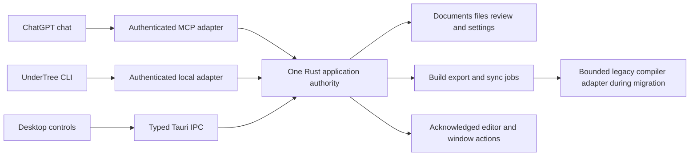

# ChatGPT full control implementation plan

User direction, 2026-10-14: make every UnderTree function controllable through ChatGPT chat, including the capabilities of both CLIs. This is the target design and implementation sequence. The running MCP server still exposes only the three review tools in [connections.md](../PROTOCOLS/connections.md); this plan enables no additional runtime access.

The intended experience is: connect once, authorize Full UnderTree control for selected projects, then ask ChatGPT to open a manuscript, edit or format it, manage its files and review rules, build/export it, adjust the workspace, and synchronize an approved destination. UnderTree applies each action through the same authority used by its own UI and CLI, and ChatGPT reports the resulting state.

## Existing paths and gaps

| Inspected path | Present behavior | Integration consequence |
| --- | --- | --- |
| `cli.mjs` → `server.mjs` | Twenty documented commands, including project/file operations, TeX builds, PDF/ZIP downloads, sync and raw local API access. Uses the legacy service's cookie token. CLI writes do not supply the optional mtime precondition accepted by the server. | Do not expose this executable or its raw `api` command directly. Bind named product operations with mandatory revision checks. Keep this CLI compatible during migration. |
| `modules/review/src/main.rs` → `Service::dispatch(Operation)` | Local JSON `call` adapter to the loopback review service, using a separate bearer token. The command currently launches `curl`; it is not yet a full named Rust CLI or a client of the running Tauri instance. | Add named CLI commands and a local transport to the existing desktop authority. Do not start a second service with independent mutable state when the desktop is already open. |
| `modules/review/src/transport.rs` → `Service::remote` | Remote `list_manuscripts`, `read_manuscript`, `suggest_text`; session shares and a private URL capability. | Keep this review mode working. Add explicit authenticated Full control tools, never an automatic export of every `Operation` variant. |
| `src/main.js`, `src/manuscript.js`, native window adapter | Source/visual editing, formatting, undo/redo, pane/navigation/settings controls, review actions, connection management and native window actions. Many live only in the frontend. | CLI wrapping cannot provide complete control. Add typed application actions and an acknowledged editor/window adapter for these functions. |

Source inspection and `node cli.mjs help` establish this inventory; they do not establish remote feature coverage. The legacy help currently reports version 0.2.0 while package metadata reports 0.2.2, so capability discovery must include an explicit contract version rather than trusting the help banner.

## Shared application authority



Keep `modules/review/` as the initial authority; its name does not justify a framework migration. Introduce action/service modules there only as implemented capabilities require them. `native/tauri/` owns the local IPC/window adapter; `modules/frontend/` owns document-session coordination; `src/` adapts editor and workspace actions to the DOM. `modules/compiler/` remains the TeX/legacy compiler owner. `cli.mjs` and the Rust executable are clients of these named operations, not remote command interpreters.

The Tauri app needs an authenticated local IPC endpoint usable by the CLI, with a single-instance handshake and an explicit unavailable response. Prefer an OS-local socket/pipe where practical; a narrowly bound authenticated loopback endpoint is an existing fallback. Starting the CLI against a running desktop must reuse that process's state and grants. Preserve a separately invoked headless service for supported document/build actions; a missing editor/window returns `ui_unavailable` rather than fabricated success.

Migrate legacy actions into Rust incrementally. A temporary adapter may invoke a fixed compiler/service operation after Rust authorization, using one approved-root mapping. Do not give a Node helper authority to expand roots, choose arbitrary URLs or bypass Rust revisions. Remove an adapter only after equivalent native behavior is qualified.

## Review mode and Full UnderTree control

| Mode | Product authority |
| --- | --- |
| Review | Existing explicitly shared manuscripts and three suggestion-only tools. No acceptance, direct edits, policy changes, Git or settings operations. |
| Full UnderTree control | Named UnderTree actions for the owner's authorized projects and workspace: direct edits, review decisions, policy management, file operations, builds, exports, settings, approved synchronization and UI/window actions. |

The initial grant names the owner, instance/generation, authorized project roots or workspace parent, allowed action groups and session lifetime. Full control is one understandable mode; action groups enforce the grant without introducing a role administration product. Within that standing grant, ordinary requested actions do not require another UnderTree desktop approval. ChatGPT's own tool confirmation behavior is client policy and cannot be disabled or promised away by UnderTree.

Full control includes deliberate review-rule changes and accepting/rejecting suggestions. Content mutations still obey currently installed protection/rejection rules and revision checks. Rule changes use a distinct versioned policy operation and appear in the activity record; raw source writes cannot edit sidecars or silently remove protection. A Full control grant that includes policy management is broader authority than a protected manuscript's review grant; do not describe it as equally restrictive.

Manage all product settings from chat through typed operations. Root additions and any increase beyond the standing grant create an exact access request for the human to approve through the supported account/consent flow; the model cannot approve itself. If chat-hosted approval is unavailable, return `requires_user_action` with a usable local route. Routine actions inside an already approved workspace need no repeated authorization. Account sign-in opens the provider's secure flow; passwords, Git credentials and zrok account tokens never become tool outputs.

“All functions” means semantic UnderTree features. OS login, native file-picker interaction, closing a stopped app and authorizing the initial connection have physical/authorization prerequisites. Provide clear request/status flows for those boundaries. A `run_cli`, shell, raw HTTP, arbitrary Tauri `invoke`, DOM script or keyboard/mouse proxy would escape the application boundary and is not the integration mechanism.

## Authentication and transport

Retain the existing zrok2 transport and dedicated MCP listener. Keep its current `/mcp/<secret>` review capability separate from an OAuth-protected Full control endpoint, proposed as `/mcp`. A review URL must never authorize Full control. Neither endpoint mounts the privileged local operation API.

Before enabling remote mutations, qualify OAuth 2.1 authorization-code/PKCE, protected-resource and authorization-server metadata, exact callback validation, audience/issuer/expiry checks, and per-request scopes bound to the native grant. Use an established implementation/provider rather than inventing authentication. Selecting a suitable maintained Rust library or existing provider is an implementation dependency decision; no provider or paid account is selected by this plan. Native approval must authenticate the owner; an unauthenticated public consent page alone is insufficient.

This follows the current [OpenAI authentication contract](https://developers.openai.com/plugins/build/auth). OAuth scopes identify permitted features; the native grant additionally restricts project roots, instance and lifetime. An MCP session ID, initialized client name or running zrok process is not authorization or verified ChatGPT identity. Do not infer possession of OpenAI mTLS identity through zrok unless the actual forwarding/termination path has been verified.

Use supported Streamable HTTP negotiation. Advertise only implemented, authorized tools with input/output schemas and truthful annotations, and reinitialize/refresh the catalogue when the grant changes. Keep standard tool results usable in plain chat; custom ChatGPT UI is optional. Put required workflow guidance in compiled server instructions/tool descriptions, outside `For-AI/` at runtime.

## CLI command coverage

All names below are proposed MCP contracts unless explicitly marked existing. They describe capabilities, not executable shell commands.

| Current legacy command | MCP function | Contract or gap |
| --- | --- | --- |
| `health` | `get_app_status` | Version/capabilities and safe readiness; omit unapproved library paths and secrets. |
| `projects` | `list_projects` | Return only projects visible to the current grant. |
| `project-add` | `create_project`, `request_project_access` | Create inside an approved workspace, or request approval for an outside folder; never silently approve a model-supplied root. |
| `tree` | `get_project_tree` | Bounded tree, stable entry IDs and continuation cursor. |
| `status` | `get_project_status` | Saved/buffer state, last build and Git identity/status without credential disclosure. |
| `search` | `search_project` | Bounded results with document revision, path and exact ranges. |
| `read` | `read_source` | Approved document/entry ID, bounded range, revision and policy context. |
| `write` | `edit_source` | Revisioned patch transaction with exact quotes, current policy and dirty-buffer coordination. Never a blind whole-file overwrite. |
| `create` | `create_entry` | File/folder variants; create-only, approved parent and collision errors. |
| `rename` | `move_entry` | Exact destination, source/tree revision and collision checks; move review metadata and update open tabs. |
| `duplicate` | `duplicate_entry` | Return the actual new entry ID/path and deterministic receipt for retries. |
| `delete` | `trash_entry`, `restore_entry` | Retain recoverable source/sidecars; report dependent/open documents and refuse an unresolved dirty buffer. No silent recursive permanent delete. |
| `reveal` | `reveal_entry` | Fixed native action for an approved entry; acknowledge whether a GUI opened. |
| `build` | `start_build` | Format/source/revision and normal/clean mode; fixed approved build profile. Return a job. |
| `build-all` | `start_project_build` | Enumerate eligible sources; bounded explicit job with per-source results. |
| `pdf-info` | `get_artifact_info` | Actual source revision, current/stale flag, page count and last-good artifact identity. |
| `pdf-save` | `export_pdf` | Return a scoped artifact/download or write inside an approved export root; no arbitrary absolute output path. |
| `pdf-bundle` | `export_project_pdfs` | Bounded ZIP job, manifest and explicit partial failures; no success if required builds failed. |
| `sync` | `sync_project` | Approved GitHub/Overleaf destination and direction, expected local/remote heads. Keep provider differences explicit. |
| `api` | Named tool for each supported product action | Raw local API remains a developer convenience. Complete feature coverage is delivered by typed tools, not public arbitrary method/path requests. |

`help` and `commands` are the CLI discovery aliases. Their remote equivalent is `get_app_capabilities` plus MCP `tools/list`, not executing help on the host.

The local Rust `Operation` variants also need explicit coverage:

| Existing operation family | Full control mapping |
| --- | --- |
| `Projects`, `AddProject`, `Files`, `Open`, `Create`, `Save` | Inventory/access/create/read/edit tools above; opening a visible tab is separately acknowledged by `open_document`. |
| `Review`, `Palette`, `Mark`, `Reanchor`, `Unmark`, `Decide` | `get_review`, `set_review_rules`, `mark_passage`, `reanchor_marker`, `remove_marker`, `decide_suggestion`; same native policy/revision checks in UI, CLI and the future authenticated Full control grant. Reanchor remains local in the implemented Review mode. |
| `Share`, `Tunnel`, `Connection` | `set_project_sharing`, `get_connection_status`, `configure_connection`, `disconnect_connection`; exact grant boundaries and connection shutdown semantics below. |
| `GitStatus`, `BindGithub`, `Sync` | `get_project_status`, `bind_sync_destination`, `sync_project`; destinations must already be authorized or go through the access request flow. |
| `Compile`, `Pdf`, `ImportTex` | `start_build`, `get_artifact_info`/`export_pdf`, `import_tex`; preserve original TeX and return the conversion report. |

Retain the existing three review tool names for compatibility. In Full control, they remain available alongside the additional tools.

## Features beyond the CLIs

| Feature observed in the UI or existing product modules | Proposed control functions and completion condition |
| --- | --- |
| Project switching, filtering, sorting, adding, removing/forgetting a project | `select_project`, `set_project_view`, `forget_project`; distinguish forgetting a registry entry from deleting its files. |
| Tabs, selection, source search/replace, navigation and file outline | `get_workspace_state`, `open_document`, `close_document`, `select_passage`, `search_document`, `replace_matches`, `get_document_outline`; explicit IDs/revisions, no dependency on whichever tab currently has focus. |
| Editing, save/autosave, undo/redo and conflict recovery | `edit_source`, `save_document`, `undo_edit`, `redo_edit`, `get_save_conflict`, `resolve_save_conflict`; preserve dirty content and require an explicit selected version for conflict resolution. |
| Bold, italic, underline, headings, lists, alignment, font/color, citations and links | `format_passage`, `insert_citation`, `set_link`; closed format-specific variants, exact ranges and revision. A UI adapter reports applied only after the editor transaction succeeds. |
| HTML source/visual mode, adaptive boxlets, object deletion, geometry/grid edits and text refit | `set_editor_mode`, `create_layout_object`, `update_layout_object`, `delete_layout_object`, `refit_layout`; stable object IDs, schema-constrained layout properties and saved print profiles. No CSS/DOM evaluation proxy. |
| Color rules, passage prompts/protection, suggestion cards, accept/reject and locate | Review functions above plus existing `suggest_text`; separate content and policy revisions, stale-anchor rejection and the same decision/escaping logic. |
| Typst, TeX and HTML/layout builds, clean builds, logs and optional Codex recovery | Build/job functions plus `get_build_diagnostics`, `start_build_recovery`; recovery is a separately authorized configured feature, not a generic agent/shell launcher. |
| PDF page, zoom, fit-width, preview visibility/reload, adaptive HTML proof | `set_preview_view`, `refresh_preview`, `show_layout_proof`; return actual page/zoom/artifact state after application. Build completion does not imply the preview rendered. |
| Source/PDF/companion-TeX exports, bundles and assets | `export_source`, `export_pdf`, `export_project_pdfs`, `export_companion_tex`, `import_asset`; bounded native staging/transfer and artifact receipts. Qualify delivery of the resulting attachment/download in real ChatGPT. |
| Editor font size/wrap, source-only filter, autosave/compile interval, sidebar/pane layout, logs and dialogs | `get_settings`, `update_settings`, `set_workspace_view`; validated setting names, ranges and enums, with the existing UI policy preserved. |
| GitHub/Overleaf bindings, status, pull/push and autosync | Sync functions above plus `set_sync_settings`; protect unrelated files, expected heads and dirty buffers. A permitted sync must not auto-resolve divergence or force-push. |
| zrok/MCP setup, sharing, status, mode, revoke, account connect/disconnect | Connection functions above plus `request_control_access`; account login/consent returns a real user-action flow. Runtime executable paths and credentials are not remotely replaceable via a generic settings field. |
| Original native frame, minimize, maximize/restore, focus, close and help | `set_window_state`, `get_app_help`; fixed actions applied by the native adapter, preserving unsaved-change handling. The remote route disappears after application shutdown; report that lifecycle honestly. |

These rows are the feature inventory to turn into runnable conformance cases. An already-implemented legacy feature remains a migration item until a named native/adapter action and actual MCP result are verified. Do not label the whole product fully controlled while those gaps remain.

## Mutation and editor contracts

Every mutating tool carries a stable `requestId` and relevant expected document/policy/tree/settings revisions. Rust associates its receipt with principal, instance/grant generation and a fingerprint of the exact request. An identical replay returns its prior result; a reused ID with different content fails. Persist write receipts before acknowledging success; an uncertain external write returns `outcome_unknown` and must be inspected before retrying.

Proposed source mutation shape:

```json
{
  "documentId": "ID returned by inventory",
  "requestId": "unique-operation-id",
  "expectedRevision": "current document revision",
  "expectedPolicyRevision": "current policy revision",
  "edits": [{"from": 3, "to": 8, "quote": "Hello", "replacement": "Greetings"}]
}
```

Offsets use the existing UTF-16 convention. Apply a bounded, nonoverlapping edit batch atomically against the exact snapshot; preserve markup rules, source-format validity requirements and installed protections. Direct authoring may intentionally change supported Typst/HTML/TeX syntax; it must not reuse the review tool's prose-only restrictions or silently bypass policies by replacing the entire source. Large sources/assets require bounded staging and digest-verified finalize, not an increase to unbounded MCP messages.

The editor buffer must be part of the action boundary. Before a remote write/build/save, reconcile outstanding local changes through a bounded document-session barrier. During IME composition or a newer unsynchronized edit, defer or reject with a recoverable conflict. Apply remote editor changes as normal transactions preserving caret, selection, decorations and undo grouping. Rust rechecks disk and policy revisions before durable commit. Never declare success from an event merely being sent to the WebView. If a window disappears during application, reconcile the receipt and native state rather than guessing whether the edit happened.

Use distinct `documentRevision`, `savedRevision`, `workspaceRevision` and policy/settings revisions where their meanings differ. Results state whether an operation is applied to a buffer, saved to disk, queued or externally verified. The native domain remains authoritative for permissions and side effects; the UI owns presentation and must acknowledge view/editor application. A disk-only adapter that conflicts with a live dirty tab is not complete editor control.

Builds, imports, exports, sync and recovery return job IDs with `get_job_status`, `read_job_log` and `cancel_job`. Bound concurrency, queues, logs, retained artifacts and polling waits. Explicit jobs cannot be lost behind an automatic-build debounce. Cancellation can stop pending/in-process work; it cannot undo an already completed push or save. A journal/receipt survives a disconnect long enough for the user to inspect uncertain results.

TeX/legacy build scripts and automatic repair deserve an explicit boundary: a project write followed by compilation must not become arbitrary host script execution. Use fixed installed compiler profiles, restricted build execution and existing tool supervision; do not accept free-form command strings or enable shell escape through a remote setting. Audit any legacy `tex-sync`/repair adapter before exposing it remotely.

Connection shutdown/rotation and window close are special lifecycle operations. Record a durable receipt and return `stop_requested`/`close_requested` before disconnecting; the connection loss alone does not prove completion. A later local CLI/new connection can inspect the receipt. Changing an origin, authentication or access mode stages the exact change and reauthorizes/reconnects as needed; it never upgrades the current client implicitly. A disconnected client cannot restart a stopped authority without a separately enabled local supervisor, which is outside this plan's default session-only lifecycle.

## Implementation sequence

| Step | Work and owners | Observable gate |
| --- | --- | --- |
| 1 | Freeze the inventory and action/result/error schemas. Add explicit caller context and capability discovery in `modules/review/`; specify named CLI forms and preserve legacy aliases. | Every CLI command, `Operation` variant and UI feature above has an owner and a conformance case; unmigrated features return `unsupported_capability`. |
| 2 | Add one-desktop-instance local CLI transport and native document-session coordination. | UI and CLI see the same buffer/settings revisions; concurrent typing/IME/external edits cannot be overwritten. |
| 3 | Qualify owner authentication, native grants, Review/Full mode selection and revocation in the existing Connections UI. Follow canonical UI/layout rules when implementing it. | The old review URL still has only three tools; Full tools reject missing/wrong/expired/revoked credentials and every out-of-root request. |
| 4 | Ship one Full control path: discover → read → edit → save → start Typst build → job result → export. | Run the same fixture through named CLI, desktop and MCP, then real ChatGPT. Verify persisted bytes, PDF source revision and chat-delivered artifact. |
| 5 | Add tree/search/create/move/duplicate/trash/restore, project creation/access and assets. | Sidecars, open tabs and stable IDs survive changes; collisions, dirty buffers, symlinks and replay/conflict tests pass. |
| 6 | Add review decisions/rules, formatting, source/visual/layout tools and workspace/native window control. | Real editor transactions, undo/redo, view acknowledgements and UI parity/layout checks pass; headless limitations are explicit. |
| 7 | Add remaining TeX/HTML builds/exports, approved recovery and GitHub/Overleaf sync/settings. | Fixed compiler and external-side-effect boundaries pass; verify remote heads and provider-specific outcomes on disposable projects. |
| 8 | Complete the chat scenarios, installed/native matrix and machine-readable coverage gate. | All inventoried product features have live supported results, explicit authorization flows or documented physical prerequisites. A mock or catalogue entry alone does not satisfy coverage. |

The first implementation target is step 1, followed by the local-instance/document-session foundation. Adding remote writes straight to the existing catalogue skips the dirty-buffer and authorization prerequisites.

## End to end acceptance

Use disposable projects and a real authenticated ChatGPT connection. The tests must include requests phrased naturally, follow-ups reusing returned IDs, wrong tool selection and denied actions. Capture authoritative revisions/receipts and externally observed results, rather than treating chat prose as proof.

1. “Create a project under my approved workspace, open a Typst manuscript, write an introduction, compile it and give me the PDF.” Verify sources, revisions, real compiler output and usable chat artifact.
2. “In my open document, make the selected paragraph clearer, bold the key term, undo that formatting and save.” Type locally and exercise IME concurrently; verify no lost edits and correct history.
3. “Protect the results paragraph, propose an alternative introduction, accept that suggestion, then change the highlight color.” Verify review/full mode separation and current protections at each mutation.
4. “Create a subfolder, duplicate this manuscript there, rename it, delete the copy, then restore it.” Verify review sidecars, open-tab references and replay safety.
5. “Show page three at fit width, open the log panel and turn automatic compilation off.” Confirm the native UI applied these actions; a stored desired setting alone is insufficient.
6. “Import this TeX manuscript into Typst; keep the original and show me what did not convert.” Verify report and original bytes.
7. “Export the HTML companion TeX and all project PDFs, then sync this checkpoint to the connected GitHub repository.” Verify artifact delivery and exact remote head. Test the Overleaf path independently.
8. “Change the connection settings, revoke this chat's access and minimize/close UnderTree.” Verify receipts, unsaved-work handling and inability to call old grants. Initial pairing and restarting an app that has fully stopped remain explicit prerequisites.

Also cover stale revisions/policies, duplicate request IDs with different bytes, unauthorized roots/accounts, corrupt sidecars, failed/slow compilers, job cancellation, huge inputs, malformed protocol requests, client disconnects, native restart, token expiry and partial/unknown external results. UI-only tests use synthetic remote calls; live ChatGPT/zrok qualification is a separate mandatory gate.

## Sources and current verification

This plan follows [OpenAI's tool-contract guidance](https://developers.openai.com/plugins/plan/tools) for focused actions, schemas and coverage, [structured tool results](https://developers.openai.com/plugins/build/mcp-server), the [authentication contract](https://developers.openai.com/plugins/build/auth), and [connection testing guidance](https://developers.openai.com/plugins/deploy/connect-chatgpt), checked 2026-10-14. Tool names, module splits and the sequence here are UnderTree design proposals, not claims that those features already exist or that OpenAI supplies UnderTree's authorization logic.

Planning verification initially found all 20 documented CLI commands and 20 Rust variants represented here. The local-only `Reanchor` action added on 2026-10-15 extends the Rust inventory to 21; its future Full control mapping is recorded above without adding remote authority. These checks establish plan consistency, not implemented Full control behavior. No runtime action, privilege, dependency, account configuration or public deployment is changed by this plan. Keep implementation evidence in [reference-evidence.md](../reference-evidence.md).
